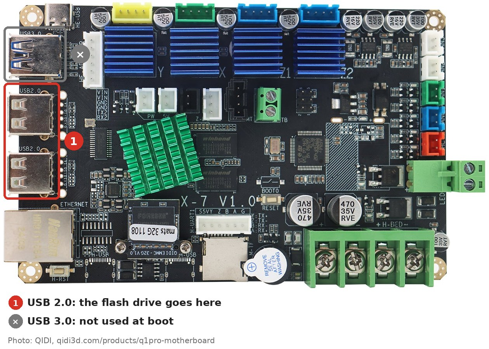

# QIDI Q1 Pro: загрузка с USB-флешки для стоковой прошивки

[English](README.md)

Этот скрипт создан для того, чтобы QIDI Q1 Pro со стоковой прошивкой мог
загружаться с USB-флешки. Так можно запустить систему восстановления или
другую прошивку, не вынимая eMMC из принтера. Для этого скрипт меняет
последовательность загрузки: если вставлена флешка с системой, принтер
загружается с неё, а без флешки — с eMMC, как обычно.

Ничего не прошивается. Установщик меняет только файлы на разделе BOOT eMMC
(`/boot`), а `uninstall` возвращает их обратно.

## Что нужно

* QIDI Q1 Pro со стоковой прошивкой QIDI. Установщик проверяет, что на eMMC
  загрузчик QIDI, и иначе не устанавливается.
* Доступ к принтеру по SSH.
* Рекомендуется: [Makerbase EMMC-ADAPTER](https://makerbase3d.com/product/makerbase-emmc-adapter-v2-usb-3-0-reader-for-mks-emmc-module-micro-sd-tf-card-mks-pi-mks-skipr/), чтобы подключить eMMC к
  компьютеру, [если принтер не загружается](#если-принтер-не-загружается).
* Необязательно, чтобы загружать что-то с USB: флешка с системой для этой
  платы, например [Armbian для `mkspi`](https://armbian.com/boards/mkspi). На
  первом или втором разделе флешки должен быть `extlinux/extlinux.conf` или
  `boot.scr` в `/` или `/boot/`. У корневого раздела должен быть свой UUID,
  поэтому копия eMMC не подойдёт.

> Всё на свой страх и риск, см. [отказ от ответственности](#отказ-от-ответственности).

## Установка

Зайти на принтер по SSH (пользователь `mks`, пароль по умолчанию
`makerbase`), скачать скрипт и запустить его от root:

```sh
curl -fLO https://raw.githubusercontent.com/LibreQ1Pro/q1pro-recovery-boot/main/q1pro-recovery-boot.sh
sudo sh q1pro-recovery-boot.sh install
```

Если у принтера нет интернета, можно через USB-флешку:

1. Скачать `q1pro-recovery-boot.sh` на компьютер и скопировать на флешку
   (FAT32 или exFAT).
2. Вставить флешку в принтер. Стоковая прошивка монтирует её как папку в
   `~/gcode_files`.
3. Найти на ней скрипт:

   ```sh
   ls ~/gcode_files/*/q1pro-recovery-boot.sh
   ```

   Команда выведет путь, например
   `/home/mks/gcode_files/sda1/q1pro-recovery-boot.sh`.
4. Запустить скрипт по этому пути:

   ```sh
   sudo sh /home/mks/gcode_files/sda1/q1pro-recovery-boot.sh install
   ```

Проверить:

```sh
sh q1pro-recovery-boot.sh status
```

Должно вывести `/boot: installed, U-Boot: qidi`.

Вернуть стоковую загрузку:

```sh
sudo sh q1pro-recovery-boot.sh uninstall
```

## Загрузка с флешки

1. Выключить принтер.
2. Вставить флешку в один из двух портов USB 2.0 на материнской плате
   (отмечены цифрой 1). Порт USB 3.0 над ними на этом этапе загрузки не
   работает.
3. Включить принтер.



Загрузка с флешки занимает около минуты.
Без флешки принтер загружается так же быстро, как раньше.

## Сигналы светодиодов

Три светодиода на материнской плате показывают, что делает загрузчик.



| Этап | Светодиоды |
|---|---|
| Включение | синий и жёлтый |
| Загрузчик запустился | все светодиоды быстро моргнут |
| Загрузка с eMMC | зелёный, жёлтый мигает 3 раза |
| Загрузка с флешки | синий, жёлтый мигает 3 раза |
| Ошибка загрузки | синий и зелёный быстро мигают, потом горит только синий |

После сигналов eMMC и флешки светодиоды возвращаются к синему и жёлтому. Если
флешки с системой не нашлось, принтер загружается с eMMC. Когда запустился
Linux, светодиодами управляет система: стоковая прошивка ими мигает, система на
флешке может оставить синий и жёлтый.

## Если принтер не загружается

Вынуть eMMC, подключить к компьютеру и на её разделе BOOT:

1. удалить `boot.scr` и `boot.cmd`;
2. переименовать `extlinux/extlinux-emmc.conf` в `extlinux/extlinux.conf`.

Это снова стоковое состояние.

---

## Подробности

### Что меняет установщик

| Файл в `/boot` | Изменение |
|---|---|
| `extlinux/extlinux.conf` | переименован в `extlinux/extlinux-emmc.conf` |
| `boot.cmd` | добавлен, исходник скрипта загрузки |
| `boot.scr` | добавлен, собран из `boot.cmd` через `mkimage` на принтере |

Загрузчик читает `extlinux/extlinux.conf` раньше `boot.scr`, поэтому файл
переименовывается. Установщик сначала собирает `boot.scr` и только потом
переименовывает файл. `uninstall` сначала возвращает файл и только потом
удаляет скрипт. Если любое из действий прервётся на середине, принтер всё равно
загрузится по-стоковому.

### Команды

```
q1pro-recovery-boot.sh {install|uninstall|status} [--boot DIR] [--bypass-check]
```

* `--boot DIR`: работать с другим каталогом вместо `/boot`.
* `--bypass-check`: пропустить проверку загрузчика. Скрипт загрузки сделан под
  загрузчик QIDI (его адреса памяти, питание USB и разводку светодиодов),
  поэтому флаг только для тестов.

Загрузчик опознаётся по SHA-256 трёх его частей на eMMC: `idbloader`
(сектор 64), `uboot.img` (сектор 16384) и `trust` (сектор 24576), снятых с
нетронутого Q1 Pro.

### Как работает скрипт загрузки

Стоковый загрузчик — U-Boot 2021.07 из сборки Armbian от QIDI. Скрипт:

1. управляет светодиодами. Они на микросхеме питания RK805 (регистр `0x52`), а
   команды для неё в этом U-Boot нет, поэтому скрипт работает с контроллером
   I2C напрямую;
2. включает питание внутреннего USB-хаба, которое этот U-Boot не включает;
3. ищет систему на флешке и загружает её;
4. иначе загружает eMMC по `extlinux/extlinux-emmc.conf`.

Порт USB 3.0 висит на контроллере USB, для которого в этом U-Boot нет драйвера.

### Отказ от ответственности

Скрипт предоставляется как есть, без каких-либо гарантий. Вы устанавливаете
его на свой страх и риск, и вся ответственность за результат лежит только на
вас. Авторы не отвечают ни за какой ущерб или потери: принтер, который не
загружается, принтер, который простаивает, пока нет способа подключить eMMC к
компьютеру, простой принтера, остановка работы или бизнеса, упущенный доход и
что угодно ещё.

### Авторские права

Скрипт и `images/led-signals.svg`: MIT, см. [LICENSE](LICENSE).

Фото платы — фото товара QIDI
(https://qidi3d.com/products/q1pro-motherboard) с нашими пометками.
